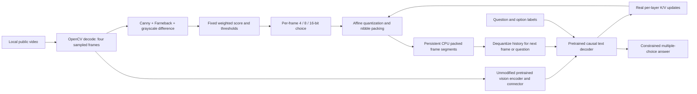

# Architecture

Historical CPU-v1 architecture follows. See [GPU design](gpu_design.md) for the current CUDA packed-pool allocator and fused attention schematic.

The native baseline replaces Q/C/U with unmodified Transformers `DynamicCache`.
All model weights, prompts, frames, causal positions and attention kernels are
otherwise shared. Fixed-bit baselines bypass F/S and assign every frame the same
bit width. Text-only prefix and question segments remain native BF16 everywhere.

## Cache lifecycle

1. Prefill the chat prefix at native 16-bit storage. Keep one cache instance.
2. Decode one sampled frame and insert its 64 visual tokens plus frame markers.
3. Advance absolute positions using `cache_position = arange(old_length, new_length)`.
4. Each decoder layer's actual `Cache.update(K,V,layer)` stores the new frame
   at its assigned bit width. The descriptor identifies layer, frame, start/end
   sequence positions and precision. Already-applied RoPE positions are preserved
   with the cached keys; they are not rotated again during reconstruction.
5. For the current attention call, concatenate reconstructed historical K/V with
   the new, unquantized current K/V. On later calls the new segment is retrieved
   from its compressed storage. This avoids quantizing the current frame's own
   attention, consistently across all compressed configurations.
6. Append the question, retrieve historical visual K/V and score option labels.
   No previous image is passed again and the vision encoder is not rerun for QA.

Different frames can simultaneously occupy 4-, 8- and 16-bit segments in every
layer. Unit tests force all three widths in one cache; the real frame timeline
reports only the widths that the unaltered heuristic actually chooses.

## Quantization representation

Flatten each `[batch, KV heads, tokens, head_dim]` segment and group consecutive
64 values. For each group, use FP32 offset `a = min(x)` and scale
`s = (max(x)-a)/(2^b-1)`. A constant group uses `s=1`. Store
`q = round((x-a)/s)` clipped to the unsigned b-bit range and reconstruct
`x_hat = q*s+a`. Pad range estimation by replicating the last value in an
incomplete group, then discard padded quantized entries. Pack two 4-bit unsigned
integers into one uint8 byte; an odd element count consumes one padded nibble.

Each packed tensor contains its payload, FP32 scales and offsets, and a real
64-byte binary header describing shape, dtype, precision, group size and counts.
Each layer/frame segment adds a real 32-byte binary mapping descriptor. Native
16-bit segments preserve BF16 bytes exactly and contain no scale/offset arrays.
The measured compressed storage includes all these tensor-backed bytes.

This symmetric treatment of K/V and contiguous group layout is a simple affine
baseline, not KIVI's asymmetric per-channel-key design. There is no rotation,
learned policy, quantized attention arithmetic or feedback calibration.
