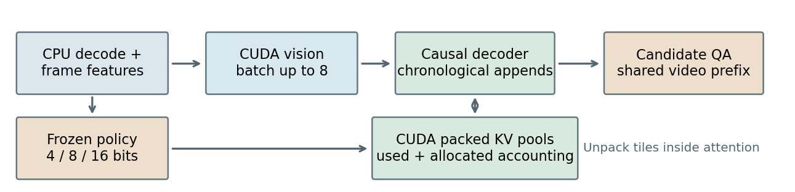
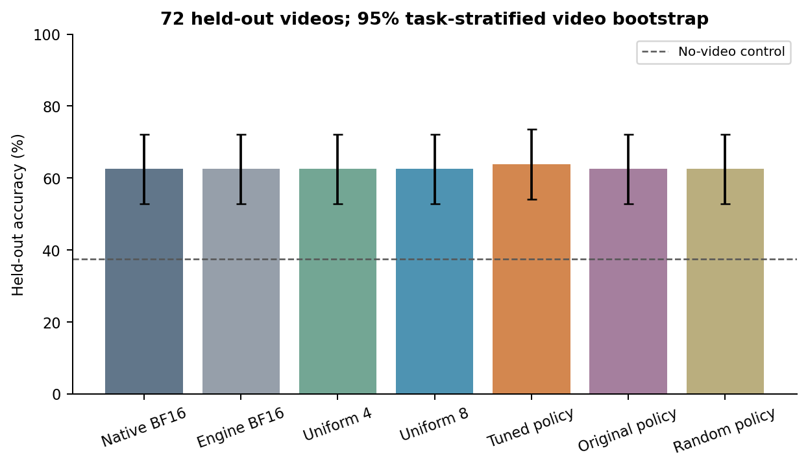
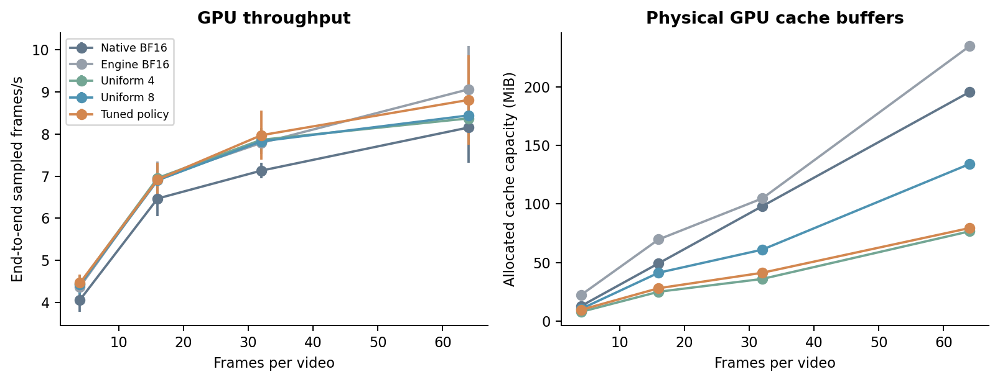

# GPU Frame-Adaptive Packed KV Storage for Local Video Question Answering

Local inference study | RTX 5070 Laptop GPU | SmolVLM2-500M | Reproducible prototype

## Abstract

We replace a CPU packing prototype with GPU-resident 4/8/16-bit KV pools and causal attention that reconstructs compressed history inside its attention tiles. The system retains actual pretrained visual keys and values across frame calls, without training model weights. A bounded validation search selects the checkpoint, answer-scoring protocol and frame policy before held-out evaluation. On 72 disjoint videos from two MVBench tasks, tuned dynamic storage obtains 63.89% accuracy versus 62.50% for native BF16. The paired difference is +1.39 percentage points (95% video-bootstrap interval [+0.00, +4.17]). At up to 16 frames, used cache bytes fall 59.5% and allocated capacity falls 43.4%. At 64 frames, complete-request throughput changes +8.0% versus native. Results apply to this checkpoint, hardware and bounded workload; they do not establish general accuracy equivalence or a universal speedup.

## 1. Motivation and scope

KV compression saves persistent storage but can add packing, reconstruction and dispatch overhead. Hugging Face explicitly notes that quantized caches can hurt latency with short contexts [1]. The earlier local CPU prototype used only eight clips, four frames and a small 7.2 MiB native cache. Its equal top-choice accuracy was a coarse, biased result, not evidence that quantization preserved model probabilities. That CPU experiment and its source are preserved in archives/cpu_v1.zip and its original result files.

This study makes four concrete changes: move inference and packed payloads to CUDA; consolidate decoder projection calls and reuse visual embeddings; fuse historical dequantization into attention; and test 4, 16, 32 and 64 real frames. Validation also compares two pretrained checkpoints and five answer protocols. The new GPU study is not an apples-to-apples speed or accuracy comparison with the old CPU run.

| Component | Delivered configuration |
|---|---|
| GPU | NVIDIA GeForce RTX 5070 Laptop GPU, 8 GiB, SM 120 |
| Runtime | Python 3.11.9; PyTorch 2.7.1+cu128; Transformers 4.51.3; Triton 3.3.1 |
| Checkpoint | SmolVLM2-500M-Video-Instruct; BF16 weights, unchanged values |
| Decoder | 32 layers; 15 query / 5 KV heads; head dimension 64 |
| Context and batch | Checkpoint limit 8192 tokens; batch one; no context extension |
| Execution | Entirely local; CPU video preparation; CUDA vision, decoder and packed KV |

The independent vision encoder processes up to eight recorded frames per batch. Their embeddings then enter the causal decoder one frame at a time with advancing rotary positions. This measures offline recorded-video processing. It does not measure latency while waiting for a live camera frame.

<!-- PAGE BREAK -->
## 2. GPU implementation and controls

Figure 1. Implementation schematic, not a performance measurement. Vision embeddings feed chronological decoder appends; the policy controls packed storage and attention reads it directly.

### Physical representation

Each decoder layer stores K and V in separate 4-, 8- and 16-bit GPU pools, shared across the sequence through a logical token map. Four-bit storage packs two integer values into each uint8 byte; eight-bit storage uses uint8; sixteen-bit storage uses BF16. Each compressed head/token vector has 64 elements and an FP32 offset and scale. For b in {4,8}, scale=(max(x)-min(x))/(2^b-1), and integer values use clamped round-to-nearest-even affine quantization. A constant vector uses scale one. Keys are quantized after rotary embedding; values use the same per-token grouping. This is not KIVI's asymmetric per-channel key design [4].

One Triton pack launch writes both K and V for a decoder layer. No historical KV payload is copied to the CPU. The logical row index is int32, the precision code uint8. The scheduler's scalar feature decisions remain on the CPU. Prefix and question tokens stay BF16. Precision applies to all tokens in a frame segment, including its image tokens, timestamp and delimiters; it is not restricted to image tokens alone.

### Causal consumption without full-history reconstruction

A tiled online-softmax attention kernel [2,3] gathers historical precision codes and rows, loads packed K/V, and reconstructs only the tile in GPU registers. It applies grouped-query attention and an explicit bottom-right causal mask. The current append's K/V remain native BF16 while attending within that append; compressed storage affects later appends. The main path allocates no full-history reconstructed K/V tensor. A separate reconstruction function exists for correctness tests and compatibility only.

Each precision pool starts at 64 rows and grows online by at least 1.5x, rounded to 64 rows. The allocator does not know future frame precisions. Growth copies live pool storage on the GPU; these copies and packing are included in timing. The token map reserves the checkpoint's 8192-token capacity. Exact question-token capacity is reserved after the video. Used bytes include payload, scales, offsets and the used map; allocated bytes include unused pool capacity and the entire map. Python object overhead is excluded from these cache-only counters. Whole-request PyTorch allocated/reserved VRAM is recorded separately.

### Reducing dispatch and temporary tensors

Q/K/V projections become one GEMM, as do gate/up projections. Exact checks preserve parameter values in consolidated storage. Normalization and SiLU/multiply use prebuilt PyTorch CUDA operations, not custom fused pointwise kernels. Every mode reuses image embeddings and omits frame-only LM-head work. CPU features overlap independent CUDA vision; tests verify identical synchronous/background values and timing includes residual waits. Sequential QA branches share the video prefix; the native cache is cropped back after each candidate.

Native BF16 uses upstream Transformers DynamicCache and SDPA with its original projection/normalization execution. Engine BF16 uses the optimized engine and the same packed-attention implementation with sixteen-bit pools. It controls for execution changes independently of low-bit quantization. Any speedup versus native includes these execution changes, online cache allocation differences and compression. The Engine BF16 comparison is necessary before attributing a gain solely to quantization.

A separate 64-frame operator profile records 15235 native versus 8707 optimized matrix-multiply calls, and 8712 versus 4424 concatenations. Device timestamps are unavailable (CUPTI_ERROR_INVALID_DEVICE), so isolated packing/unpacking device time is not reported. Windows blocked an experimental launcher; the delivered earlier API works without security changes. Failed logs are retained.

<!-- PAGE BREAK -->
## 3. Validation, policy search and evaluation design

Public MVBench [6] is pinned to revision 230a2d4fac8900333c61754641c7a13e069ac9c6. Seeded splits exclude the original eight clips: 36 validation videos (24 action-antonym, 12 fine-grained-action) and 72 held-out videos (48 and 24). Paths and video hashes are disjoint. Sequential decoding samples up to 16 distinct actual frames evenly, without repetition. One validation clip has 15 frames; one held-out clip has 5, giving a held-out mean of 15.85.

Validation compares 256M and 500M SmolVLM2 [5] with five protocols: three letter-token conventions, candidate likelihood, and candidate likelihood adjusted by a no-video prior. The selected 500M candidate protocol scores 63.89% versus 33.33% without video; the 256M counterpart scores 58.33% versus 52.78%. Selection uses all cyclic option rotations. Every final GPU mode shares the selected checkpoint and protocol.

The answer is the candidate with maximum mean conditional token log-likelihood, avoiding letter-token conventions. Cyclic rotations yield 120 validation and 240 held-out questions, clustered into 36 and 72 video units, not extra independent clips. No external judge is used. The no-video control retains the question and candidate strings.

### Bounded policy search

The search tests 12 dynamic policies plus three fixed controls. Edge density, Farneback flow and grayscale difference feed varied weights, thresholds and first-frame/periodic anchors; two variants omit features. Scales are validation-only 95th percentiles. Per-frame decisions use current and previous frames, without future-clip normalization. Scheduler validation scores one candidate order; held-out evaluation checks every rotation.

| Validation policy | Accuracy % | Used saving | Allocated saving |
|---|---|---|---|
| uniform4 | 63.89 | 67.9% | 49.2% |
| uniform8 | 63.89 | 43.2% | 16.2% |
| fused16 | 63.89 | -0.0% | -41.6% |
| original | 63.89 | 58.7% | 42.7% |
| edges_only | 63.89 | 43.3% | 18.9% |
| difference_only | 63.89 | 53.9% | 36.8% |
| motion | 63.89 | 50.0% | 33.9% |
| difference | 63.89 | 50.8% | 34.2% |
| balanced | 63.89 | 48.3% | 29.3% |
| edges | 63.89 | 43.3% | 20.6% |
| conservative | 63.89 | 34.5% | 12.8% |
| budget | 63.89 | 59.3% | 41.7% |
| motion_anchor | 63.89 | 51.2% | 34.7% |
| difference_anchor | 63.89 | 50.9% | 35.0% |
| periodic | 63.89 | 51.9% | 33.9% |

Among dynamic policies saving at least 25% in both used and allocated bytes, selection maximizes validation accuracy, then used-byte reduction, then native-score fidelity. All 15 candidates tied on top-choice validation accuracy, so memory decided the winner; this is not evidence of an accuracy gain from tuned weights. The winner uses weights (0.2, 0.4, 0.4), scales (0.15013, 4.76145, 0.12758), thresholds (0.55, 0.90) and an 8-bit first-frame floor. The original rule is retained as an ablation. This bounded search does not establish global optimality. The frozen configuration includes the test-manifest hash and predates held-out inference.

<!-- PAGE BREAK -->
## 4. Held-out accuracy and cache storage

| Cache mode | Accuracy % | Delta pp | Used MiB | Allocated MiB |
|---|---|---|---|---|
| Native BF16 | 62.50 | +0.00 | 48.9 | 48.9 |
| Engine BF16 | 62.50 | +0.00 | 48.9 | 69.1 |
| Uniform 4-bit | 62.50 | +0.00 | 15.7 | 24.8 |
| Uniform 8-bit | 62.50 | +0.00 | 27.8 | 40.9 |
| Tuned dynamic | 63.89 | +1.39 | 19.8 | 27.7 |
| Original dynamic | 62.50 | +0.00 | 20.7 | 28.8 |
| Random precision | 62.50 | +0.00 | 19.8 | 26.4 |

Table 1. Means over 72 held-out videos, requesting 16 frames (71 clips yield 16, one yields 5). Cache snapshots precede QA. Prefix/question tokens remain BF16. Random precision draws from validation precision frequencies with a deterministic per-video seed, matching the distribution in expectation rather than each clip's exact byte budget.

Figure 2. Accuracy uses the video as the statistical unit. Bars show 95% task-stratified bootstrap intervals from 10,000 resamples. The dashed line is the same-protocol no-video control (37.50%).

Tuned dynamic accuracy is 63.89% with interval [54.17, 73.61]%. Its paired difference from native is +1.39 pp with interval [+0.00, +4.17]. Top-choice answer agreement with native is 98.61%. Candidate log-likelihood scores have RMSE 0.2543 and maximum absolute change 1.2778 versus native. Matching accuracy does not mean matching keys, values or probabilities: different predictions can offset, and score changes often do not cross a decision boundary.

The dynamic policy saves 59.5% of used bytes and 43.4% of physically allocated cache capacity. The smaller capacity saving reflects online growth, initially reserved pools, mapping capacity and QA space. We report both rather than describe theoretical low-bit payload ratios as measured VRAM savings. Peak whole-model memory is not reduced by this same percentage because weights and visual activations remain present.

The two selected tasks and small local sample do not represent all 20 MVBench tasks. Bootstrap uncertainty is conditional on this fixed checkpoint, policy and sampled task mixture. There is no formal non-inferiority conclusion and no guarantee of accuracy preservation on other videos.

<!-- PAGE BREAK -->
## 5. GPU throughput and longer contexts

| Frames | Native fps | Dynamic fps | Change | Native / dynamic capacity MiB |
|---|---|---|---|---|
| 4 | 4.06 | 4.47 | +9.9% | 12.8 / 9.6 |
| 16 | 6.47 | 6.92 | +7.0% | 49.3 / 28.1 |
| 32 | 7.13 | 7.97 | +11.8% | 98.1 / 41.2 |
| 64 | 8.16 | 8.81 | +8.0% | 195.6 / 79.4 |

Table 2. End-to-end sampled frames per second. Each context has three real validation clips, three repetitions and five cache configurations (180 measured requests). Clip choice used task membership and sufficient real frames, not answer correctness. Configuration order rotates across requests. Warmups and model loading are excluded.

Figure 3. Throughput includes decode, CPU preparation/features, vision, causal frame appends, packing/growth, and complete candidate QA. CPU features overlap vision; unhidden waits count as preparation, so feature runtime is not additive. Error bars show sample SDs of three repetition-level means on the same clips, not population uncertainty across arbitrary videos.

| 64-frame mode | Total s | Decoder s | QA s | Frames/s |
|---|---|---|---|---|
| Native BF16 | 7.901 | 4.884 | 0.257 | 8.16 |
| Engine BF16 | 7.119 | 4.153 | 0.206 | 9.06 |
| Uniform 4-bit | 7.663 | 4.618 | 0.236 | 8.37 |
| Uniform 8-bit | 7.585 | 4.520 | 0.243 | 8.44 |
| Tuned dynamic | 7.331 | 4.342 | 0.228 | 8.81 |

At 64 frames, dynamic throughput changes +8.0% relative to native and -2.8% relative to Engine BF16. The native comparison is not a compression-only gain. Longer input raises traffic and attention compute; low-bit decode arithmetic and mixed-pool loads remain. Absolute speeds varied across separately scheduled runs, so serial-versus-overlap timings are not an isolated causal A/B. Final claims use matched controls within the final run.

Timing synchronizes CUDA at component boundaries. Each repetition-level throughput is total actual sampled frames divided by total request seconds across its three clips. Full candidate scoring is teacher-forced likelihood evaluation, not free-text token generation; these frames/s and QA/s are not decode-token/s. Timing uses validation clips, whereas primary quality uses held-out clips. The 64-frame native cache averages 5007 tokens and 195.6 MiB, substantially larger than the original 7.2 MiB CPU experiment. All inputs stay within the pretrained context limit.

<!-- PAGE BREAK -->
## 6. Limits, reproducibility and next experiments

### Related work

FlashAttention [2] and Triton's attention tutorial [3] motivate tiled attention without materializing attention matrices. KIVI [4] studies asymmetric key/value quantization; our simpler per-token affine groups are a different design. SmolVLM [5] supplies the pretrained weights and MVBench [6] supplies public video questions. None of their published speed or accuracy figures is adopted as a result here.

This prototype supports inference only, batch one, 64-dimensional heads and this Llama-based decoder. It does not implement paged serving, concurrent QA, eviction, beam search, gradients or arbitrary architectures. Prefix and QA storage remain BF16; a frame's precision is fixed at ingestion. This streaming adaptation is not a streaming-trained model or an official benchmark run. Held-out means excluded from our selection; overlap with model pretraining is not audited.

Policy calibration is limited to 36 validation clips and a hand-designed candidate family. Better accuracy research would broaden task and clip coverage, compare per-channel keys with per-token values, and fit a scheduler to score distortion or uncertainty while retaining a separate validation split. Better speed research would specialize homogeneous precision tiles, tune GQA sharing and tile sizes, reduce online growth copies, and evaluate near the 8192-token checkpoint limit. Those are future experiments, not delivered claims. The present study prioritizes a measured GPU path, real physical packing and transparent controls.

The workspace retains separate CPU and CUDA environments, both checkpoints, pinned public data, failed exploratory logs and the CPU-v1 archive. It remains below the user-authorized 15 GB cap. Model weights are loaded as BF16 but downloaded in their public FP32 checkpoint form. No cloud credits, paid services, private accounts, system-wide installations, security changes or destructive cleanup are used.

The final audit checks hashes, split separation, policy freeze consistency, row counts, per-frame precision, physical bytes, GPU tests, CLI output and PDF visual inspection. Exact environment, source and checkpoint identities are in results/gpu_provenance.json; the audit is results/gpu_verification.json. Raw answers and timings are in results/raw/gpu_test_quality.jsonl and gpu_timing.jsonl, with CSV tables in results/. Original CPU evidence remains results/metrics.json and archives/cpu_v1.zip.

### Conclusion

GPU-resident packed storage and attention that consumes compressed tiles provide a working alternative to CPU packing and full-history reconstruction. Measured accuracy, allocated capacity and complete-request throughput must be assessed together; this bounded study does not establish a universally superior scheduler.

## References

[1] Hugging Face. [Transformers 4.51.3: KV cache strategies](https://huggingface.co/docs/transformers/v4.51.3/en/kv_cache). Quantization trades memory against overhead; short-context latency can worsen.

[2] Dao et al. [FlashAttention: Fast and Memory-Efficient Exact Attention with IO-Awareness](https://arxiv.org/abs/2205.14135), 2022. Source of the tiled online-softmax formulation, not a benchmark result reproduced here.

[3] Triton. [Fused attention tutorial](https://triton-lang.org/main/getting-started/tutorials/06-fused-attention.html). Implementation reference; the delivered mixed-pool kernel is local source.

[4] Liu et al. [KIVI: A Tuning-Free Asymmetric 2bit Quantization for KV Cache](https://arxiv.org/abs/2402.02750), 2024. Related quantization research, not an implemented baseline.

[5] Marafioti et al. [SmolVLM: Redefining small and efficient multimodal models](https://arxiv.org/abs/2504.05299), 2025. Public 500M video checkpoint pinned to revision 7b375e1b73b11138ff12fe22c8f2822d8fe03467.

[6] Li et al. [MVBench: A Comprehensive Multi-modal Video Understanding Benchmark](https://arxiv.org/abs/2311.17005), 2024. Only two tasks are evaluated here; original source-video research-use terms apply.
